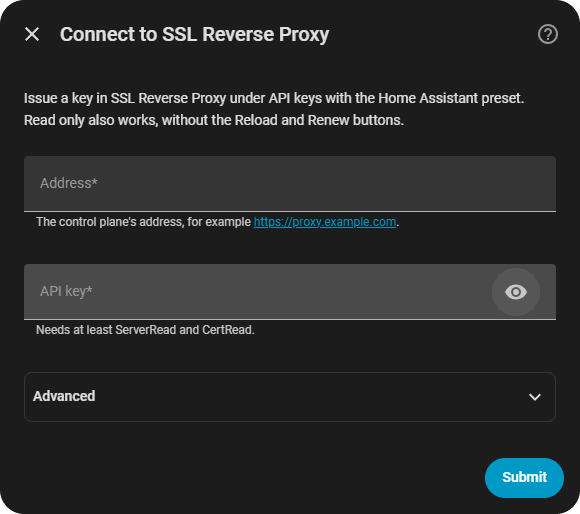
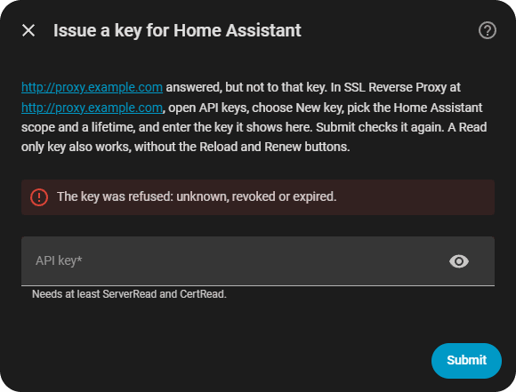
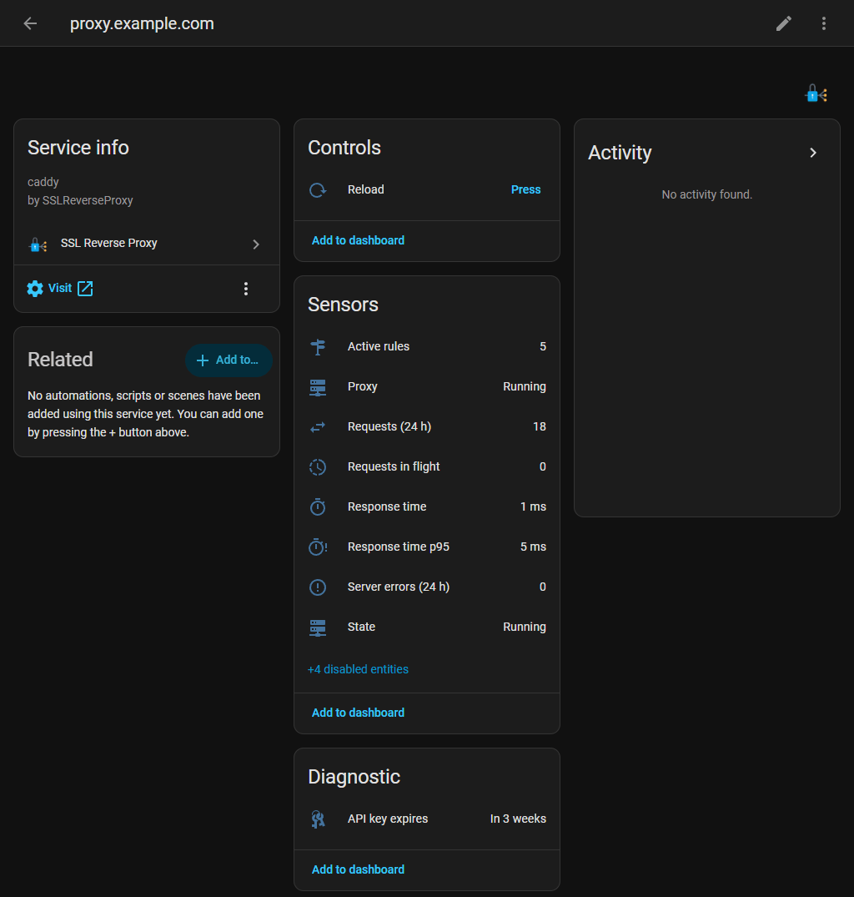

# SSL Reverse Proxy for Home Assistant

Monitors and controls an [SSLReverseProxy](https://github.com/heidrickla/SSLReverseProxy) control plane: the proxy's state and traffic, each proxied server's upstream health, each certificate's expiry and renewal, and Reload and Renew from Home Assistant.

## Screenshots



Setup asks for the control plane's address and an API key.



A refused key leads to a screen that says how to issue one and checks again.



The proxy device, captured against the test suite's recorded control-plane answers.

## What you get

| Device | One per | Model |
|---|---|---|
| The installation, named after its host | config entry | the proxy engine (`caddy`) |
| A server | server the control plane lists | the server's operating system |
| A certificate | certificate the control plane lists | the issuer |

Server and certificate devices sit under the installation's device. They appear and disappear with the control plane's lists.

| Entity | Device | Type | Default |
|---|---|---|---|
| State | installation | sensor, enum: `stopped`, `running`, `faulted`, `unavailable`, `unknown` | enabled |
| Proxy | installation | binary sensor, running | enabled |
| Active rules | installation | sensor | enabled |
| Requests (24 h) | installation | sensor | enabled |
| Requests in flight | installation | sensor | enabled |
| Server errors (24 h) | installation | sensor, 5xx responses | enabled |
| Client errors (24 h) | installation | sensor, 4xx responses | disabled |
| Response time, Response time p95 | installation | sensor, ms | enabled |
| Time to first byte | installation | sensor, ms | disabled |
| Data received (24 h), Data sent (24 h) | installation | sensor, MB | disabled |
| API key expires | installation | sensor, timestamp, diagnostic | enabled |
| Reload | installation | button | with `ProxyReload` |
| Status | server | sensor, enum: `active`, `inactive`, `error`, `unknown` | enabled |
| Upstreams | server | binary sensor, problem: on while fewer upstreams answer than are configured | enabled |
| Upstreams up | server | sensor | enabled |
| Upstreams, Rules | server | sensor, diagnostic | enabled |
| Expires | certificate | sensor, timestamp | enabled |
| Status | certificate | sensor, enum: `valid`, `expiring`, `expired`, `issuing`, `failed`, `unknown` | enabled |
| Renewal pending | certificate | binary sensor, diagnostic | enabled |
| Renew | certificate | button, ACME-managed certificates only | with `CertRenew` |

The Upstreams binary sensor is `unknown` until the control plane has probed the server once.

### Actions

| Action | Fields | Does |
|---|---|---|
| `sslreverseproxy.reload` | `config_entry_id` | Pushes the stored configuration to the proxy. Needs `ProxyReload`. |
| `sslreverseproxy.renew_certificate` | `config_entry_id`, `certificate` (the domain, for example `app.example.com`) | Forces a renewal of an ACME-managed certificate. Needs `CertRenew`. |

Both actions and both buttons run for administrators and for automations and scripts. A call or a press by a user who is not an administrator is refused with `Unauthorized`. The client checks the same rule against the call's own context before it sends any write, so every route to the control plane meets it. A refusal from the control plane, such as a renewal already in progress, comes back with the control plane's message, with the key taken out of it.

## Requirements

- Home Assistant 2026.10 or later.
- An SSLReverseProxy control plane that answers `GET /api/instance` with API version 1.
- An API key. In SSL Reverse Proxy, open API keys, choose New key, pick the Home Assistant scope and a lifetime (1, 7, 30, 90 or 365 days). The Home Assistant scope grants `ServerRead`, `CertRead`, `ProxyReload` and `CertRenew`. A Read only key works too, without the buttons and actions.

## Installation

[](https://my.home-assistant.io/redirect/hacs_repository/?owner=heidrickla&repository=ha-sslreverseproxy&category=integration)

1. Press the button above. HACS (Home Assistant 2026.10) or the Marketplace (2026.11 and later) opens this repository and offers to add it. Download it; HACS asks for a restart afterwards, the Marketplace loads it without one.
2. Press this button to start the setup:

[](https://my.home-assistant.io/redirect/config_flow_start/?domain=sslreverseproxy)

The setup has one screen, and a second only when the key is the problem:

1. Connect to SSL Reverse Proxy: enter the control plane's address and the API key, then press Submit.
2. Issue a key for Home Assistant: shown only when the address answered but refused the key, or the key lacks `ServerRead` or `CertRead`. It says how to issue one with the Home Assistant scope; enter the new key and press Submit to check it again. The address and certificate check you entered are kept.

The Advanced section of the first screen holds Verify the TLS certificate, on by default; turn it off only for a control plane with a self-signed certificate.

Without the buttons: HACS, the three-dot menu, Custom repositories, add `https://github.com/heidrickla/ha-sslreverseproxy` as an Integration, download SSL Reverse Proxy and restart; then Settings, Devices & services, Add integration, SSL Reverse Proxy. Manual install: copy `custom_components/sslreverseproxy/` into your Home Assistant `config/custom_components/` directory and restart.

### Installation parameters

| Field | Meaning |
|---|---|
| Address | The control plane's address, for example `https://proxy.example.com`. A trailing `/api` is removed. User names, queries and fragments are refused. |
| API key | A key with at least `ServerRead` and `CertRead`. |
| Verify the TLS certificate (Advanced) | On by default. Turn it off only for a self-signed certificate. |

Setup reads `/api/instance` and `/api/whoami` before the entry is created. An unreachable address and an unsupported API version are shown on the first screen; a refused key and a key without `ServerRead` and `CertRead` lead to the key step. The flow only reads; it never reloads or renews. The installation's instance id is the entry's unique id: adding an installation that is already configured updates the existing entry. The key is never sent back to the form.

### Reconfiguring

Settings -> Devices & Services -> SSL Reverse Proxy -> Reconfigure changes the address, the key and the certificate check. Its Advanced section opens while the certificate check is off, and on an error. A blank key keeps the current one. The address must answer as the same installation. There are no options beyond these.

### Replacing the key

- A key the control plane refuses (revoked, expired, or missing `ServerRead` or `CertRead`) stops polling and starts reauthentication, which asks for a new key.
- Seven days before the key expires, a repair issue names the key and its expiry. Its fix takes the new key, checks it, and reloads the entry. Rotate on SSL Reverse Proxy's API keys page issues a replacement that starts from the old key's owner, scope and lifetime.
- Every route that takes a new key checks that the address still answers as the installation the entry was set up for.

The grants are read when the entry loads: after widening a key's scope, reload the entry to get the Reload and Renew buttons.

### Removing it

Settings -> Devices & Services -> SSL Reverse Proxy -> Delete. That removes the entry, its devices and every entity. Then revoke the key in SSL Reverse Proxy under API keys. A server or certificate device whose server or certificate the control plane no longer lists can also be deleted from its device page; the installation's device and listed ones cannot.

## How it updates

| What | Interval |
|---|---|
| Proxy status, servers, traffic and the key's record | 60 s |
| Certificates | 15 min |

The control plane keeps traffic as 24-hour aggregates, so the counts cover the last 24 hours and a faster poll adds nothing. A failed poll marks that poll's entities unavailable; the failure and the recovery are each logged once. Buttons and actions refresh their entities after they run. Every id the control plane returns (instance, server, certificate, API key) is read as a UUID, and an answer holding another form is refused as malformed.

## Examples

A notification two weeks before a certificate expires:

```yaml
automation:
  - alias: Certificate expires in two weeks
    triggers:
      - trigger: template
        value_template: >-
          {{ as_timestamp(states('sensor.app_example_com_expires'), 0) - as_timestamp(now()) < 14 * 86400 }}
    actions:
      - action: notify.notify
        data:
          message: "app.example.com expires {{ states('sensor.app_example_com_expires') }}"
```

A notification when a server's upstreams have been down for five minutes:

```yaml
automation:
  - alias: Upstream down
    triggers:
      - trigger: state
        entity_id: binary_sensor.web_applications_upstreams
        to: "on"
        for: "00:05:00"
    actions:
      - action: notify.notify
        data:
          message: "{{ states('sensor.web_applications_upstreams_up') }} of {{ states('sensor.web_applications_upstreams') }} upstreams answer"
```

A renewal when a certificate's status turns `failed`:

```yaml
automation:
  - alias: Retry a failed certificate
    triggers:
      - trigger: state
        entity_id: sensor.app_example_com_status
        to: failed
    actions:
      - action: sslreverseproxy.renew_certificate
        data:
          config_entry_id: 01JXXXXXXXXXXXXXXXXXXXXXXX
          certificate: app.example.com
```

## Known limitations

- The control plane does not push changes, so Home Assistant sees a change within one poll: 60 s for the proxy and servers, 15 minutes for certificates.
- The control plane does not announce itself on the network, so there is no discovery. Add it by address.
- Renew covers certificates Caddy obtains over ACME. An uploaded certificate has no Renew button, and the action passes on the control plane's refusal. A certificate's Renew button is removed when it stops being ACME-managed and added when it becomes managed.
- Request, error and data counts are 24-hour aggregates kept by the control plane.

## Troubleshooting

| Symptom | Cause |
|---|---|
| "The key lacks ServerRead or CertRead" | Issue a key with the Home Assistant or Read only scope. |
| "That address answers as a different SSL Reverse Proxy installation" | The address now reaches another installation. Reconfigure the entry with the right address, or add the other installation as its own entry. |
| "This control plane speaks an API version this integration does not" | Update the integration or the control plane so both speak API version 1. |
| No Reload button, or no Renew buttons | The key lacks `ProxyReload` or `CertRenew`, or the certificate is not ACME-managed. Reload the entry after changing the key's scope. |
| An action or button fails with `Unauthorized` | The user is not an administrator. |
| Every entity unavailable | The control plane did not answer. Check the address, the certificate check, and `GET /api/instance` from the Home Assistant host. |
| A repair issue says the key expires soon | Rotate or issue a key in SSL Reverse Proxy and enter it in the repair. |

```yaml
logger:
  logs:
    custom_components.sslreverseproxy: debug
```

Download diagnostics from the installation's device page for a report with the key, the address, the instance id, every row id, server name, host and certificate domain, and every error message redacted.

## Development

- `custom_components/sslreverseproxy/api.py` and `models.py` import nothing from Home Assistant. `tests/test_api.py` and `tests/test_models.py` run them on a bare interpreter against `tests/fixtures/`, which are answers recorded from a control plane running its demo data, with documentation addresses only.
- `tests/ha/` covers the Home Assistant layer against the same recorded answers. The GitHub Tests workflow runs both suites on Home Assistant 2026.10.2 (pytest-homeassistant-custom-component 0.13.373) on Python 3.14, measured into one coverage figure that fails under 95%, with mypy in strict mode. `tests/ha/test_actions.py` presses every entity the integration creates through every action of its domain, and calls every action of the integration, as a user who is not an administrator; each must be refused before anything but a read reaches the control plane, and every entity class the platforms define must be among those created. The same file calls the client directly with every kind of caller and checks that each write carries its own call's context. `tests/test_api.py` checks that only the client's request method touches the HTTP session.
- `python tools/validate_local.py` is the offline half of the hassfest and HACS checks plus the cross-file checks: every user-facing exception has a translation key, every action registers as an administrator action, every button press method checks the user before anything else, and the published tree carries no private address or listed development host name (`HA_DEV_HOST_NAMES`, comma separated).
- `python tools/make_brand.py` regenerates the brand images and checks their sizes and transparency.

```bash
python -m pytest tests/test_models.py tests/test_api.py -p no:homeassistant
python -m pytest tests/ha
python -m ruff check .
python -m ruff format --check .
python -m mypy custom_components/sslreverseproxy
python tools/validate_local.py
```

## Quality scale

Built to Home Assistant's Integration Quality Scale, tracked rule by rule in [`quality_scale.yaml`](custom_components/sslreverseproxy/quality_scale.yaml). All 54 rules are met; the six that do not apply are marked `exempt` with the reason. `tools/validate_local.py` checks the file against the pinned rule list and refuses a rule marked `done` that the repository contradicts. The scale is a core-integration concept; a custom integration builds to the rules and is not scored.

Changes are listed in [CHANGELOG.md](CHANGELOG.md).

## Licence

MIT.
